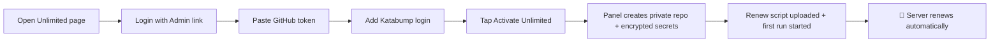
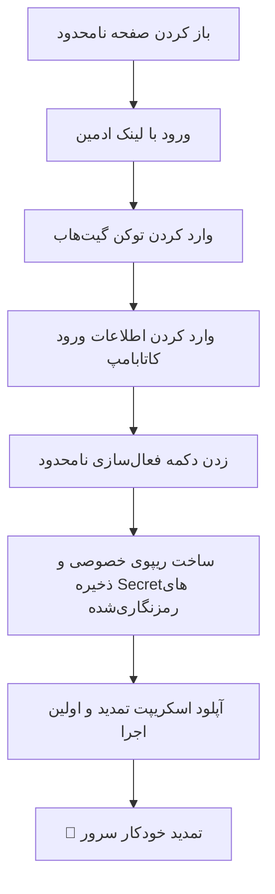

<p align="center">
  
</p>

<div align="center">

# ⚡ Parham Confing
### 🚀 Glass-UI Multi-Protocol Control Panel with Built-in Unlimited Auto-Renew
**Crafted with ❤️ by Parham - 01**

<br/>

<!-- Language Switcher Buttons -->
<p align="center">
  <a href="#-english">
    
  </a>
  &nbsp;&nbsp;
  <a href="#-فارسی-persian">
    
  </a>
</p>

<!-- Technology & Project Badges -->
<p align="center">
  
  
  
  
  
  
  
  
</p>

<!-- Quick Navigation Bar -->
<p align="center">
  <a href="#-about-the-project">📖 About</a> • 
  <a href="#-key-features">✨ Features</a> • 
  <a href="#-how-to-run">🚀 Quick Start</a> • 
  <a href="#️-unlimited-mode-auto-renew-on-katabump">♾️ Unlimited</a> • 
  <a href="#️-configuration">⚙️ Config</a> • 
  <a href="#-project-structure">📁 Structure</a> • 
  <a href="#-community--support">📣 Community</a>
</p>

</div>

---

<br/>

<!-- ========================================================================================= -->
<!--                                    ENGLISH SECTION                                        -->
<!-- ========================================================================================= -->

<div dir="ltr" align="left">

# 🇬🇧 English

## 📖 About the Project

**Parham Confing** is a lightweight, self-contained web control panel for creating and managing multi-protocol proxy configs on **Katabump free containers** and standard **Linux VPS** servers. The whole panel — backend, UI, and assets — lives in a single `index.js`.

> [!TIP]
> **Two files, zero database.** Upload `index.js` and `package.json`, wait a few seconds, and your panel is online. No manual GitHub scripts either — the **Unlimited** page sets up auto-renew for you.

---

## ✨ Key Features

<table>
  <thead>
    <tr>
      <th width="30%">Feature</th>
      <th width="70%">Description</th>
    </tr>
  </thead>
  <tbody>
    <tr>
      <td>🎨 <b>Dark Glass UI</b></td>
      <td>After-Effects-style animated glassmorphism interface with 5 color themes, animated top bar, bottom navigation, and a pixel-art home scene.</td>
    </tr>
    <tr>
      <td>🔗 <b>Multi-Protocol Configs</b></td>
      <td>Create your own configs and pick one or several protocols: <code>Hysteria2</code>, <code>VLESS</code> (WS / HTTPUpgrade / gRPC), <code>VMess-WS</code>, <code>Trojan-WS</code>, <code>ShadowTLS + VLESS</code>, <code>Shadowsocks</code> — plus optional <code>WireGuard</code>, <code>TUIC</code>, <code>XHTTP</code>, <code>SOCKS</code>, <code>HTTP proxy</code>, and <code>Argo</code>.</td>
    </tr>
    <tr>
      <td>👥 <b>Per-User Management</b></td>
      <td>Make a separate link for every user with its own traffic quota and expiry. Choose <b>Private</b> (personal, speed-optimized) or <b>Public</b> (shared, stable) mode, with live connected-user counters.</td>
    </tr>
    <tr>
      <td>📡 <b>Subscription Links</b></td>
      <td>Ready-made subs: Base64, Base64 Full, Clash / Meta, Sing-box, WireGuard <code>.conf</code>, and a panel link with QR code.</td>
    </tr>
    <tr>
      <td>♾️ <b>Unlimited Mode</b></td>
      <td>Paste a GitHub token and the panel creates a private repo, encrypts the secrets, uploads the renew script, and starts the first run — all by itself.</td>
    </tr>
    <tr>
      <td>🛡️ <b>Server Power & Guard</b></td>
      <td>Start / Stop / Check your Katabump server from the panel, plus a 30-second GitHub Actions guard that restarts it if it ever goes down.</td>
    </tr>
    <tr>
      <td>📊 <b>Live Monitor</b></td>
      <td>CPU, RAM, disk and connection gauges, per-protocol traffic bars, and a live events log.</td>
    </tr>
    <tr>
      <td>💾 <b>Backup & Restore</b></td>
      <td>Download / restore your UUID and passwords so links survive a server reset.</td>
    </tr>
    <tr>
      <td>🌐 <b>Bilingual & Responsive</b></td>
      <td>Persian (RTL) and English, fully responsive on desktop, tablet, and mobile.</td>
    </tr>
  </tbody>
</table>

### 🧩 Supported Protocols

| Protocol | Default |
| :--- | :---: |
| Hysteria2 | ✅ On |
| VLESS (WS) | ✅ On |
| VLESS (HTTPUpgrade) | ✅ On |
| VLESS (gRPC) | ✅ On |
| VMess (WS) | ✅ On |
| Trojan (WS) | ✅ On |
| ShadowTLS + VLESS | ✅ On |
| Shadowsocks | ✅ On |
| VLESS (XHTTP) | ⬜ Off |
| WireGuard | ⬜ Off |
| TUIC | ⬜ Off |
| SOCKS / HTTP proxy | ⬜ Off |
| Argo tunnel | ⬜ Off |

> [!NOTE]
> Traffic quota is metered on WS, HTTPUpgrade, Trojan-WS and VMess-WS configs. Other protocols are controlled by expiry and subscription status only.

---

## 🚀 How to Run

### 1️⃣ System Requirements
* **Node.js** `v18.0.0` or higher
* A **Katabump** container **or** any **Linux VPS** (Ubuntu, Debian, CentOS, etc.)

### 2️⃣ Upload Files
Transfer the core files to your server working directory (e.g., `/home/container/` on Katabump):

```text
📁 /home/container/
├── 📜 index.js
└── 📜 package.json
```

### 3️⃣ Start & Open the Panel

The start script runs `node index.js`. On Katabump it starts automatically after upload; on a VPS run:

```bash
npm install
npm start
```

> [!NOTE]
> Wait about **5 to 10 seconds** for dependencies to load and the web server to come up.

Check the server console — the panel address and an **Admin link** are printed there:

```bash
http://YOUR_SERVER_IP:PORT/parham-confing
```

Open it in your browser. The default internal port is `2705` and the default panel path is `parham-confing`.

### 4️⃣ Admin Access

Management pages need an **admin key**. Paste the **Admin link** from the console (the whole link or only the key) into the **Unlimited** page, tap **🔑 Login**, and you're in. You can copy the admin link again from the same page and store it somewhere safe.

> [!WARNING]
> Treat the Admin link like a password. Anyone who has it can manage your panel.

---

## ♾️ Unlimited Mode (Auto-Renew on Katabump)

Katabump free containers need to be renewed regularly. The **Unlimited** (نامحدود) page automates this with a free **GitHub Actions** workflow — **no manual scripts, no copy-pasting files**.



### 🛠️ Step-by-Step Setup

1. **Open the Unlimited page** and log in with your Admin link.
2. **Create a GitHub token** using the built-in shortcut button (or go to [github.com/settings/tokens](https://github.com/settings/tokens/new?scopes=repo,workflow)). Tick only:

   | Scope | Why it's needed |
   | :--- | :--- |
   | `repo` | Create the private repository and upload the renew script |
   | `workflow` | Create and run the GitHub Actions workflow |

   An animated in-panel guide (**راهنما**) and a video tutorial walk you through it.
3. **Fill in the form:** GitHub token, your Katabump login, and the Server ID (the last part of your server URL).
   - **Cookie login (optional):** instead of a password you can paste your logged-in Katabump cookies (e.g. from the *Cookie-Editor* extension) and press **Analyze** — the panel detects the main session cookie automatically. An optional Gemini API key makes detection more accurate.
4. **Tap `∞ Activate Unlimited`.** The panel creates a **private repo**, stores your credentials as **encrypted GitHub Secrets**, uploads the renew script, and runs it once.
5. **Watch the status card.** You'll see the schedule, last/next run, success rate, login validity, and recent GitHub runs. Use **Run now** for an instant renew, or **Disconnect** to remove everything.

> [!IMPORTANT]
> Official Katabump portal: [control.katabump.com](https://control.katabump.com)

### 🛡️ Server Power & 30-Second Guard

Once Unlimited is active, a control card lets you **Start**, **Check**, or **Stop** your server. The optional **Guard** runs on GitHub Actions and checks the server every 30 seconds, starting it again automatically if it went offline. Pressing **Stop** pauses the guard so the server doesn't come back on its own.

You can also add **extra accounts** (server ID + password) to keep several servers online.

---

## ⚙️ Configuration

Advanced options live in the `BK_CONFIG` block at the top of `index.js`:

| Option | Default | Description |
| :--- | :---: | :--- |
| `publicPort` | `2705` | Port the panel listens on |
| `panelPath` | `parham-confing` | URL path of the panel |
| `panelToken` | `""` | Optional fixed admin token (used as your key if set) |
| `domain` / `forceHost` | `""` | Force the host shown in generated links |
| `enable.*` | see protocol table | Turn each protocol on / off |
| `singBoxVersion` | `1.11.15` | sing-box core version |
| `unlimited.repo` | `katabump-auto-renew` | Name of the private auto-renew repo |

---

## 📁 Project Structure

```bash
📦 Parham-Confing
 ┣ 📜 index.js        # Server, panel UI & core logic (single file)
 ┣ 📜 package.json    # Dependencies and start script
 ┣ 📜 README.md      # This file
 ┗ 📁 banner
    ┗ 🖼️ banner.png   # README banner
```

### 📦 Dependencies

| Package | Purpose |
| :--- | :--- |
| `express` | Web server and panel API |
| `axios` | HTTP requests (GitHub API & more) |
| `libsodium-wrappers` | Encrypts credentials into GitHub Secrets |

---

## 🛠️ Pro Tips & Troubleshooting

- 🔄 **Stale Browser Cache:** After updates, do a **Hard Refresh** (`Ctrl + Shift + R` or `Cmd + Shift + R`).
- 🛡️ **Panel Won't Open:** On a VPS make sure your firewall (`ufw` / `iptables`) allows the assigned port.
- 🔑 **Lost the Admin Link:** Restart the server and read it again from the console, or set `panelToken` in `BK_CONFIG`.
- ❌ **"Login Invalid" on Home:** The status chip explains why (wrong password, Cloudflare block, captcha…). Fix it and press **Run now** again.
- 💾 **Before Resetting the Server:** Download a backup from **Upload Settings** so your links keep working after restore.
- 📲 **Client Compatibility:** Works with **v2rayN**, **v2rayNG**, **Hiddify**, **Clash Meta**, and **Sing-box**.

---

## 📣 Community & Support

Join our community for updates, configs, and help:

<p align="center">
  <a href="https://t.me/parham_ste01" target="_blank">
    
  </a>
  &nbsp;&nbsp;&nbsp;&nbsp;
  <a href="https://t.me/+SchgZ4s1dGU4N2Y0" target="_blank">
    
  </a>
</p>

<div align="center">

| Community | Direct Link |
| :--- | :--- |
| 📢 **Official Channel** | [t.me/parham_ste01](https://t.me/parham_ste01) |
| 💬 **Support Group** | [t.me/+SchgZ4s1dGU4N2Y0](https://t.me/+SchgZ4s1dGU4N2Y0) |

</div>

</div>

<br/>
<br/>

---

<!-- ========================================================================================= -->
<!--                                    PERSIAN SECTION                                        -->
<!-- ========================================================================================= -->

<div dir="rtl" align="right">

# 🇮🇷 فارسی (Persian)

## 📖 درباره پروژه

**پرهام کانفیگ (Parham Confing)** یک کنترل پنل وب سبک و مستقل برای ساخت و مدیریت کانفیگ‌های پروکسی چندپروتکله روی **سرورهای رایگان Katabump** و انواع **سرور مجازی لینوکس (VPS)** است. کل پنل — بک‌اند، رابط کاربری و فایل‌های جانبی — داخل یک فایل `index.js` قرار دارد.

> [!TIP]
> **دو فایل، بدون دیتابیس.** فقط `index.js` و `package.json` را آپلود کنید و چند ثانیه صبر کنید تا پنل آنلاین شود. حتی نیازی به اسکریپت دستی گیت‌هاب نیست؛ بخش **نامحدود** تمدید خودکار را برایتان راه‌اندازی می‌کند.

---

## ✨ امکانات و ویژگی‌های برجسته

<div dir="rtl">

| قابلیت | توضیحات |
| :---: | :--- |
| 🎨 **طراحی شیشه‌ای (Glass UI)** | رابط تیره و مدرن با انیمیشن‌های سبک افترافکتس، ۵ تم رنگی، نوار بالا و منوی پایین متحرک و صحنه پیکسل‌آرتی در صفحه اصلی |
| 🔗 **چند پروتکل همزمان** | ساخت کانفیگ دلخواه با انتخاب یک یا چند پروتکل: `Hysteria2`، `VLESS` (‏WS / HTTPUpgrade / gRPC)، `VMess-WS`، `Trojan-WS`، `ShadowTLS + VLESS`، `Shadowsocks` و به‌صورت اختیاری `WireGuard`، `TUIC`، `XHTTP`، `SOCKS`، `HTTP Proxy` و `Argo` |
| 👥 **مدیریت کاربران** | لینک جداگانه برای هر کاربر با حجم و زمان اختصاصی؛ حالت **شخصی** (بهینه برای سرعت) یا **عمومی** (اشتراکی و پایدار) و نمایش تعداد کاربران متصل به‌صورت زنده |
| 📡 **لینک‌های ساب** | ساب آماده برای Base64، Base64 Full، Clash / Meta، Sing-box، فایل `.conf` وایرگارد و لینک پنل همراه با QR |
| ♾️ **حالت نامحدود** | با دادن توکن گیت‌هاب، پنل خودش ریپوی خصوصی می‌سازد، Secretها را رمزنگاری می‌کند، اسکریپت تمدید را آپلود و اولین اجرا را شروع می‌کند |
| 🛡️ **کنترل سرور و نگهبان** | روشن / خاموش / بررسی سرور Katabump از داخل پنل، به‌علاوه‌ی نگهبان ۳۰ ثانیه‌ای روی GitHub Actions که اگر سرور خاموش شد دوباره روشنش می‌کند |
| 📊 **مانیتور زنده** | گیج‌های CPU، رم، دیسک و اتصالات، نمودار ترافیک هر پروتکل و لاگ رویدادها |
| 💾 **بکاپ و بازگردانی** | دانلود و بازگردانی UUID و رمزها تا بعد از ریست سرور لینک‌ها عوض نشوند |
| 🌐 **دوزبانه و ریسپانسیو** | فارسی (راست‌به‌چپ) و انگلیسی؛ کاملاً سازگار با کامپیوتر، تبلت و موبایل |

</div>

### 🧩 پروتکل‌های پشتیبانی‌شده

<div dir="rtl">

| پروتکل | وضعیت پیش‌فرض |
| :---: | :---: |
| Hysteria2 | ✅ روشن |
| VLESS (WS) | ✅ روشن |
| VLESS (HTTPUpgrade) | ✅ روشن |
| VLESS (gRPC) | ✅ روشن |
| VMess (WS) | ✅ روشن |
| Trojan (WS) | ✅ روشن |
| ShadowTLS + VLESS | ✅ روشن |
| Shadowsocks | ✅ روشن |
| VLESS (XHTTP) | ⬜ خاموش |
| WireGuard | ⬜ خاموش |
| TUIC | ⬜ خاموش |
| SOCKS / HTTP Proxy | ⬜ خاموش |
| Argo Tunnel | ⬜ خاموش |

</div>

> [!NOTE]
> مصرف حجم روی کانفیگ‌های WS، HTTPUpgrade، Trojan-WS و VMess-WS شمارش می‌شود؛ بقیه پروتکل‌ها فقط با زمان و وضعیت لینک ساب کنترل می‌شوند.

---

## 🚀 راهنمای سریع راه‌اندازی

### ۱️⃣ پیش‌نیازها
* **Node.js** نسخه **۱۸ به بالا**
* کانتینر **Katabump** یا هر نوع **VPS لینوکس** (اوبونتو، دبیان، سنت‌او‌اس و...)

### ۲️⃣ آپلود فایل‌ها
فایل‌های اصلی پروژه را در مسیر اصلی سرور (مثلاً `/home/container/` در کاتابامپ) آپلود کنید:

```text
📁 /home/container/
├── 📜 index.js
└── 📜 package.json
```

### ۳️⃣ اجرا و ورود به پنل

اسکریپت اجرا دستور `node index.js` است. روی کاتابامپ بعد از آپلود خودکار اجرا می‌شود؛ روی VPS این دستورها را بزنید:

```bash
npm install
npm start
```

> [!NOTE]
> حدود **۵ تا ۱۰ ثانیه** صبر کنید تا پکیج‌ها بارگذاری و وب‌سرور آماده شود.

در کنسول سرور، آدرس پنل و **Admin link** چاپ می‌شود:

```bash
http://YOUR_SERVER_IP:PORT/parham-confing
```

آدرس را در مرورگر باز کنید. پورت پیش‌فرض داخلی `2705` و مسیر پیش‌فرض پنل `parham-confing` است.

### ۴️⃣ دسترسی مدیریت

بخش‌های مدیریتی به **کلید ادمین** نیاز دارند. لینک **Admin link** که در کنسول چاپ شده را (کل لینک یا فقط کلید) در صفحه **نامحدود** وارد کنید و روی **🔑 ورود** بزنید. بعد از ورود می‌توانید لینک ادمین را از همان صفحه کپی کرده و جای امنی نگه دارید.

> [!WARNING]
> لینک ادمین مثل رمز عبور است؛ هر کسی که آن را داشته باشد می‌تواند پنل شما را مدیریت کند.

---

## ♾️ حالت نامحدود (تمدید خودکار سرور رایگان کاتابامپ)

سرورهای رایگان Katabump نیاز به تمدید منظم دارند. صفحه **نامحدود** این کار را با یک ورک‌فلو رایگان **GitHub Actions** خودکار می‌کند؛ **بدون اسکریپت دستی و بدون کپی کردن فایل**.



### 🛠️ مراحل راه‌اندازی گام‌به‌گام

1. **صفحه نامحدود** را باز کنید و با لینک ادمین وارد شوید.
2. **ساخت توکن گیت‌هاب:** با دکمه میان‌بر داخل پنل (یا از [github.com/settings/tokens](https://github.com/settings/tokens/new?scopes=repo,workflow)) توکن بسازید و فقط این دو مورد را تیک بزنید:

   | دسترسی | دلیل نیاز |
   | :--- | :--- |
   | `repo` | ساخت ریپوی خصوصی و آپلود اسکریپت تمدید |
   | `workflow` | ساخت و اجرای ورک‌فلو GitHub Actions |

   یک راهنمای متحرک داخل پنل (**راهنما**) و یک ویدیوی آموزشی مراحل را نشانتان می‌دهد.
3. **پر کردن فرم:** توکن گیت‌هاب، اطلاعات ورود کاتابامپ و Server ID (قسمت آخر آدرس سرور) را وارد کنید.
   - **ورود با کوکی (اختیاری):** به‌جای رمز عبور می‌توانید کوکی‌های لاگین‌شده‌ی کاتابامپ را (مثلاً با افزونه‌ی *Cookie-Editor*) Paste کنید و **آنالیز** را بزنید؛ پنل خودش کوکی اصلی نشست را تشخیص می‌دهد. با دادن API Key جمنای (اختیاری) تشخیص دقیق‌تر هم می‌شود.
4. **دکمه `∞ فعال‌سازی نامحدود` را بزنید.** پنل یک **ریپوی خصوصی** می‌سازد، اطلاعات شما را به‌صورت **Secret رمزنگاری‌شده** در گیت‌هاب ذخیره می‌کند، اسکریپت تمدید را آپلود می‌کند و یک بار اجرایش می‌کند.
5. **وضعیت را ببینید.** کارت وضعیت زمان‌بندی، آخرین و بعدی اجرا، نرخ موفقیت، اعتبار لاگین و اجراهای اخیر GitHub را نشان می‌دهد. با **اجرای فوری تمدید** می‌توانید همان لحظه تمدید کنید و با **قطع و حذف** همه‌چیز را پاک کنید.

> [!IMPORTANT]
> آدرس پنل اصلی کاتابامپ: [control.katabump.com](https://control.katabump.com)

### 🛡️ کنترل سرور و نگهبان ۳۰ ثانیه‌ای

بعد از فعال شدن نامحدود، یک کارت کنترل برای **روشن**، **بررسی** و **خاموش** کردن سرور دارید. **نگهبان** (اختیاری) روی GitHub Actions اجرا می‌شود، هر ۳۰ ثانیه وضعیت سرور را چک می‌کند و اگر خاموش شده بود خودکار دوباره روشنش می‌کند. با زدن **خاموش**، نگهبان متوقف می‌شود تا سرور دوباره خودش روشن نشود.

همچنین می‌توانید **اکانت‌های اضافه** (آیدی سرور + پسورد) اضافه کنید تا چند سرور همیشه روشن بمانند.

---

## ⚙️ تنظیمات پیشرفته

گزینه‌های پیشرفته در بلوک `BK_CONFIG` بالای فایل `index.js` قرار دارند:

| گزینه | مقدار پیش‌فرض | توضیحات |
| :--- | :---: | :--- |
| `publicPort` | `2705` | پورتی که پنل روی آن اجرا می‌شود |
| `panelPath` | `parham-confing` | مسیر آدرس پنل |
| `panelToken` | `""` | توکن ثابت ادمین (در صورت تنظیم، همان کلید شماست) |
| `domain` / `forceHost` | `""` | اجبار هاست نمایش‌داده‌شده در لینک‌ها |
| `enable.*` | طبق جدول پروتکل‌ها | روشن / خاموش کردن هر پروتکل |
| `singBoxVersion` | `1.11.15` | نسخه هسته sing-box |
| `unlimited.repo` | `katabump-auto-renew` | نام ریپوی خصوصی تمدید خودکار |

---

## 📁 ساختار فایل‌های پروژه

```bash
📦 Parham-Confing
 ┣ 📜 index.js        # سرور، رابط پنل و هسته پردازشی (تک‌فایل)
 ┣ 📜 package.json    # پیش‌نیازها و اسکریپت اجرا
 ┣ 📜 README.md      # همین فایل
 ┗ 📁 banner
    ┗ 🖼️ banner.png   # بنر سربرگ ریدمی
```

### 📦 پیش‌نیازهای نرم‌افزاری

| پکیج | کاربرد |
| :--- | :--- |
| `express` | وب‌سرور و API پنل |
| `axios` | درخواست‌های HTTP (API گیت‌هاب و...) |
| `libsodium-wrappers` | رمزنگاری اطلاعات برای Secretهای گیت‌هاب |

---

## 🛠️ نکات کلیدی و رفع اشکال

* 🔄 **عدم نمایش تغییرات:** بعد از هر آپدیت، کش مرورگر را با `Ctrl + Shift + R` خالی کنید (Hard Refresh).
* 🛡️ **عدم باز شدن پنل:** روی VPS مطمئن شوید پورت مورد نظر در فایروال (`ufw` یا `iptables`) باز است.
* 🔑 **گم شدن لینک ادمین:** سرور را ری‌استارت کنید و دوباره از کنسول بخوانید، یا `panelToken` را در `BK_CONFIG` تنظیم کنید.
* ❌ **«Login Invalid» در صفحه اصلی:** چیپ وضعیت دلیل را توضیح می‌دهد (رمز اشتباه، بلاک Cloudflare، کپچا و...). مشکل را رفع کنید و دوباره **اجرای فوری تمدید** را بزنید.
* 💾 **قبل از ریست سرور:** از بخش **آپلود تنظیمات** بکاپ بگیرید تا بعد از بازگردانی لینک‌ها کار کنند.
* 📲 **کلاینت‌های تست‌شده:** سازگار با **v2rayN**، **v2rayNG**، **Hiddify**، **Clash Meta** و **Sing-box**.

---

## 📣 کانال و گروه پشتیبانی تلگرام

برای دریافت آپدیت‌ها، کانفیگ و پاسخ به سوالات به کامیونیتی ما بپیوندید:

<p align="center">
  <a href="https://t.me/parham_ste01" target="_blank">
    
  </a>
  &nbsp;&nbsp;&nbsp;&nbsp;
  <a href="https://t.me/+SchgZ4s1dGU4N2Y0" target="_blank">
    
  </a>
</p>

<div align="center">

| بخش | لینک مستقیم |
| :---: | :--- |
| 📢 **کانال رسمی** | [t.me/parham_ste01](https://t.me/parham_ste01) |
| 💬 **سوپرگروه گفتگو و رفع اشکال** | [t.me/+SchgZ4s1dGU4N2Y0](https://t.me/+SchgZ4s1dGU4N2Y0) |

</div>

</div>

<br/>

---

<!-- Footer -->
<p align="center">
  <sub>⚡ Crafted with passion by <b>Parham - 01</b> • Designed for the Open Source Community ⚡</sub><br/>
  <sub>⭐ If you found this project helpful, please give it a star! ⭐</sub>
</p>
