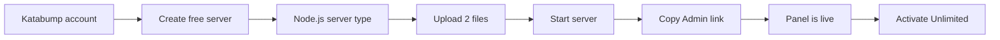
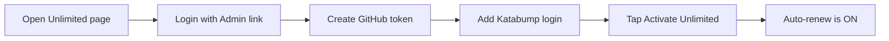
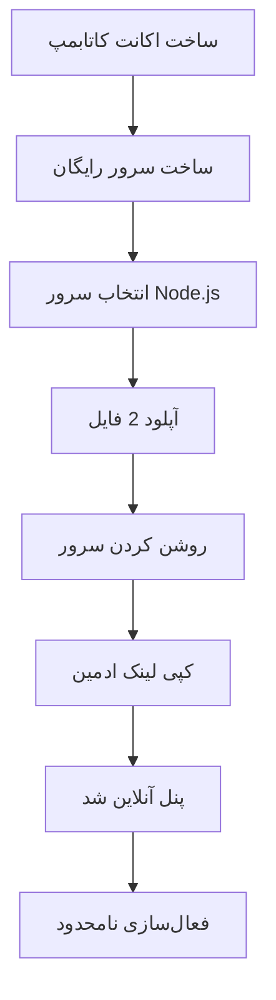
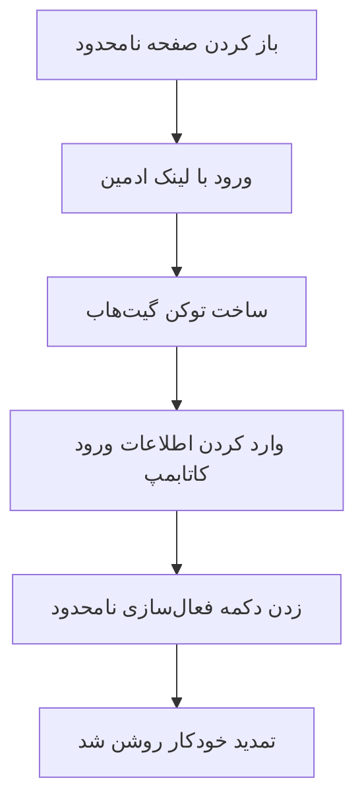

<p align="center">
  
</p>

<div align="center">

# ⚡ PARHAM CONFING ⚡

<a href="https://t.me/parham_ste01">
  
</a>

**Crafted with ❤️ by Parham - 01**

<br/>

<!-- Language Switcher Buttons (English only) -->
<p align="center">
  <a href="#-english">
    
  </a>
  &nbsp;&nbsp;
  <a href="#-فارسی-persian">
    
  </a>
</p>

<!-- Technology & Project Badges -->
<p align="center">
  
  
  
  
  
  
  
</p>

<!-- Quick Navigation Bar -->
<p align="center">
  <a href="#-about-the-project">📖 About</a> • 
  <a href="#-key-features">✨ Features</a> • 
  <a href="#-step-by-step-setup-on-katabump">🚀 Setup</a> • 
  <a href="#️-unlimited-mode-auto-renew">♾️ Unlimited</a> • 
  <a href="#️-configuration">⚙️ Config</a> • 
  <a href="#-join-the-community">📣 Join</a>
</p>

</div>

---

<br/>

<!-- ========================================================================================= -->
<!--                                    ENGLISH SECTION                                        -->
<!-- ========================================================================================= -->

<div dir="ltr" align="left">

# 🇬🇧 English

## 📖 About the Project

**Parham Confing** is a lightweight, self-contained web control panel for creating and managing multi-protocol proxy configs on a **Katabump free server**. The entire panel — backend, UI, and assets — lives in a single `index.js`.

> [!TIP]
> **Two files. Zero database. Zero manual scripts.**
> Upload `index.js` + `package.json`, wait a few seconds, and your panel is live.

<div align="center">

| 📤 Upload | ⏱️ Wait | 🌐 Open | ♾️ Unlimited |
| :---: | :---: | :---: | :---: |
| 2 files | 5 to 10 seconds | Your panel link | One tap activation |

</div>

---

## ✨ Key Features

<table>
  <thead>
    <tr>
      <th width="30%">Feature</th>
      <th width="70%">Description</th>
    </tr>
  </thead>
  <tbody>
    <tr>
      <td>🎨 <b>Dark Glass UI</b></td>
      <td>After-Effects-style animated glassmorphism interface with 5 color themes, animated top bar, bottom navigation, and a pixel-art home scene.</td>
    </tr>
    <tr>
      <td>🔗 <b>Multi-Protocol Configs</b></td>
      <td>Create your own configs and pick one or several protocols: <code>Hysteria2</code>, <code>VLESS</code> (WS / HTTPUpgrade / gRPC), <code>VMess-WS</code>, <code>Trojan-WS</code>, <code>ShadowTLS + VLESS</code>, <code>Shadowsocks</code> — plus optional <code>WireGuard</code>, <code>TUIC</code>, <code>XHTTP</code>, <code>SOCKS</code>, <code>HTTP proxy</code> and <code>Argo</code>.</td>
    </tr>
    <tr>
      <td>👥 <b>Per-User Management</b></td>
      <td>A separate link for every user with its own traffic quota and expiry. Choose <b>Private</b> (personal, speed-optimized) or <b>Public</b> (shared, stable) mode, with live connected-user counters.</td>
    </tr>
    <tr>
      <td>📡 <b>Subscription Links</b></td>
      <td>Ready-made subs: Base64, Base64 Full, Clash / Meta, Sing-box, WireGuard <code>.conf</code>, plus a panel link with QR code.</td>
    </tr>
    <tr>
      <td>♾️ <b>Unlimited Mode</b></td>
      <td>Activate it once and your free server keeps itself alive — no more renewing by hand.</td>
    </tr>
    <tr>
      <td>🛡️ <b>Server Power & Guard</b></td>
      <td>Start / Stop / Check your Katabump server from the panel, plus an optional 30-second guard that starts it again if it ever goes down.</td>
    </tr>
    <tr>
      <td>📊 <b>Live Monitor</b></td>
      <td>CPU, RAM, disk and connection gauges, per-protocol traffic bars, and a live events log.</td>
    </tr>
    <tr>
      <td>💾 <b>Backup & Restore</b></td>
      <td>Download / restore your UUID and passwords so links survive a server reset.</td>
    </tr>
    <tr>
      <td>🌐 <b>Bilingual & Responsive</b></td>
      <td>Persian (RTL) and English, fully responsive on desktop, tablet and mobile.</td>
    </tr>
  </tbody>
</table>

### 🧩 Supported Protocols

| Protocol | Default |
| :--- | :---: |
| Hysteria2 | ✅ On |
| VLESS (WS) | ✅ On |
| VLESS (HTTPUpgrade) | ✅ On |
| VLESS (gRPC) | ✅ On |
| VMess (WS) | ✅ On |
| Trojan (WS) | ✅ On |
| ShadowTLS + VLESS | ✅ On |
| Shadowsocks | ✅ On |
| VLESS (XHTTP) | ⬜ Off |
| WireGuard | ⬜ Off |
| TUIC | ⬜ Off |
| SOCKS / HTTP proxy | ⬜ Off |
| Argo tunnel | ⬜ Off |

> [!NOTE]
> Traffic quota is metered on WS, HTTPUpgrade, Trojan-WS and VMess-WS configs. Other protocols are controlled by expiry and subscription status only.

---

## 🚀 Step-by-Step Setup on Katabump

<div align="center">


</div>



###  Open Katabump and Log In

<div align="center">

<a href="https://dashboard.katabump.com/auth/login" target="_blank">
  
</a>
&nbsp;&nbsp;
<a href="https://control.katabump.com" target="_blank">
  
</a>

</div>

<br/>

**Checklist**

- [ ] Open the login page with the button above
- [ ] Log in, or create a free account if you don't have one
- [ ] Keep the control portal handy — your servers are managed there


```text
https://dashboard.katabump.com/auth/login
```


```text
https://control.katabump.com
```

> [!IMPORTANT]
> Your free server is created and managed from the control portal. Everything in the next steps happens there.

###  Create a Free Server That Supports Node.js

When you create your free server, pick the **Node.js** server type.

<div align="center">


&nbsp;


</div>

###  Upload the Two Files

Open your server's **Files** page and upload both files into the main (root) folder — on Katabump that's `/home/container/`:

```text
/home/container/
├── index.js
└── package.json
```

| File | Purpose |
| :--- | :--- |
| `index.js` | The whole panel: server, interface and core logic |
| `package.json` | Project info and start script |

> [!TIP]
> Names must match exactly: `index.js` and `package.json` — no extra characters, and not inside another folder.

###  Start the Server

Go to the **Console** page and press **Start**. On start, the Node.js server reads `package.json` and loads what the panel needs.

> [!NOTE]
> Wait **5 to 10 seconds** for the panel to boot.

###  Copy the Admin Link

The console prints your panel address and an **Admin link**. Copy the admin link and keep it private — it's your key to management.

> [!CAUTION]
> The Admin link works like a password. Never share it or post it publicly.

###  Open Your Panel

Open the panel address printed in the console (the default path is `parham-confing`):

```text
http://YOUR_SERVER_IP:PORT/parham-confing
```

###  Log In as Admin

| Where | What to do |
| :--- | :--- |
| `Unlimited` page | Paste the **Admin link** (the whole link, or just the key) |
| `Login` button | Tap it — management pages are now unlocked |

###  Create Your First Config

`Configs` ➔ `Create Config` ➔ pick one or several protocols ➔ choose **Private** or **Public** ➔ set traffic and days ➔ done. Copy the link or scan the QR code in your client.

###  Activate Unlimited

Continue to the next section to make your free server renew itself.

---

## ♾️ Unlimited Mode (Auto-Renew)

**Unlimited** keeps your free server online around the clock. Activate it once, and your server renews itself — no more renewing by hand, no more expired servers.

<div align="center">

| Manual renewals | Activation | Server |
| :---: | :---: | :---: |
| 0 | One tap | Always renewed |

</div>



### 🛠️ Setup

1. **Create a GitHub token** with the built-in shortcut button (or open the link below). Tick only these two scopes:

   | Scope | Required |
   | :--- | :---: |
   | `repo` | ✅ |
   | `workflow` | ✅ |

   📋 Token page:
   ```text
   https://github.com/settings/tokens/new?scopes=repo,workflow
   ```
   An animated in-panel guide and a video tutorial walk you through it.

2. **Fill in the form:** GitHub token, your Katabump login, and the Server ID (the last part of your server URL).
   - 🍪 **Cookie login (optional):** instead of a password you can paste your logged-in Katabump cookies (for example from the *Cookie-Editor* extension) and press **Analyze** — the panel detects the main session cookie automatically. An optional Gemini API key makes detection more accurate.

3. **Tap `∞ Activate Unlimited`.** The panel sets everything up and runs your first renew.

4. **Watch the status card.** It shows the schedule, last/next run, success rate, login validity and recent runs. Use **Run now** for an instant renew or **Disconnect** to turn Unlimited off.

### 🛡️ Server Power & 30-Second Guard

Once Unlimited is active, a control card lets you **Start**, **Check** or **Stop** your server. The optional **Guard** checks the server every 30 seconds and starts it again if it went offline. Pressing **Stop** pauses the guard so the server doesn't come back on its own.

You can also add **extra accounts** (server ID + password) to keep several servers online.

---

## ⚙️ Configuration

Advanced options live in the `BK_CONFIG` block at the top of `index.js`:

| Option | Default | Description |
| :--- | :---: | :--- |
| `publicPort` | `2705` | Port the panel listens on |
| `panelPath` | `parham-confing` | URL path of the panel |
| `panelToken` | `""` | Optional fixed admin token (used as your key if set) |
| `domain` / `forceHost` | `""` | Force the host shown in generated links |
| `enable.*` | see protocol table | Turn each protocol on / off |
| `singBoxVersion` | `1.11.15` | sing-box core version |

---

## 📁 Project Structure

```bash
📦 Parham-Confing
 ┣ 📜 index.js        # Server, panel UI & core logic (single file)
 ┣ 📜 package.json    # Project info and start script
 ┣ 📜 README.md       # This file
 ┗ 📁 banner
    ┗ 🖼️ banner.png   # README banner
```

---

## 🛠️ Troubleshooting

<details>
<summary><b>🔄 Changes don't show up after an update</b></summary>
<br/>
Do a hard refresh: <kbd>Ctrl</kbd> + <kbd>Shift</kbd> + <kbd>R</kbd> (or <kbd>Cmd</kbd> + <kbd>Shift</kbd> + <kbd>R</kbd> on Mac).
</details>

<details>
<summary><b>🚫 The panel won't start</b></summary>
<br/>
Make sure your server uses the <b>Node.js</b> type, and that both <code>index.js</code> and <code>package.json</code> are in the root folder with the exact names.
</details>

<details>
<summary><b>🔑 I lost the Admin link</b></summary>
<br/>
Restart the server and read it again from the console, or set <code>panelToken</code> inside <code>BK_CONFIG</code>.
</details>

<details>
<summary><b>❌ "Login Invalid" shows on the Home page</b></summary>
<br/>
The status chip explains why (wrong password, Cloudflare block, captcha…). Fix it, then press <b>Run now</b> again.
</details>

<details>
<summary><b>💾 Resetting the server?</b></summary>
<br/>
Download a backup from <b>Upload Settings</b> first, so your links keep working after you restore.
</details>

<details>
<summary><b>📲 Which apps work?</b></summary>
<br/>
<b>v2rayN</b>, <b>v2rayNG</b>, <b>Hiddify</b>, <b>Clash Meta</b> and <b>Sing-box</b>.
</details>

</div>

<br/>
<br/>

---

<!-- ========================================================================================= -->
<!--                                    PERSIAN SECTION                                        -->
<!-- ========================================================================================= -->

<div dir="rtl" align="right">

# 🇮🇷 فارسی (Persian)

## 📖 درباره پروژه

**پرهام کانفیگ (Parham Confing)** یک کنترل پنل وب سبک و مستقل برای ساخت و مدیریت کانفیگ‌های پروکسی چندپروتکله روی **سرور رایگان Katabump** است. کل پنل — بک‌اند، رابط کاربری و فایل‌های جانبی — داخل یک فایل `index.js` قرار دارد.

> [!TIP]
> **دو فایل. بدون دیتابیس. بدون اسکریپت دستی.**
> فقط `index.js` و `package.json` را آپلود کنید و چند ثانیه صبر کنید؛ پنل آنلاین می‌شود.

<div align="center">

| 📤 آپلود | ⏱️ صبر | 🌐 باز کردن | ♾️ نامحدود |
| :---: | :---: | :---: | :---: |
| 2 فایل | 5 تا 10 ثانیه | لینک پنل شما | فعال‌سازی با یک کلیک |

</div>

---

## ✨ امکانات و ویژگی‌های برجسته

<div dir="rtl">

| قابلیت | توضیحات |
| :---: | :--- |
| 🎨 **طراحی شیشه‌ای (Glass UI)** | رابط تیره و مدرن با انیمیشن‌های سبک افترافکتس، 5 تم رنگی، نوار بالا و منوی پایین متحرک و صحنه پیکسل‌آرتی در صفحه اصلی |
| 🔗 **چند پروتکل همزمان** | ساخت کانفیگ دلخواه با انتخاب یک یا چند پروتکل: `Hysteria2`، `VLESS` (‏WS / HTTPUpgrade / gRPC)، `VMess-WS`، `Trojan-WS`، `ShadowTLS + VLESS`، `Shadowsocks` و به‌صورت اختیاری `WireGuard`، `TUIC`، `XHTTP`، `SOCKS`، `HTTP Proxy` و `Argo` |
| 👥 **مدیریت کاربران** | لینک جداگانه برای هر کاربر با حجم و زمان اختصاصی؛ حالت **شخصی** (بهینه برای سرعت) یا **عمومی** (اشتراکی و پایدار) و نمایش تعداد کاربران متصل به‌صورت زنده |
| 📡 **لینک‌های ساب** | ساب آماده برای Base64، Base64 Full، Clash / Meta، Sing-box، فایل `.conf` وایرگارد و لینک پنل همراه با QR |
| ♾️ **حالت نامحدود** | یک بار فعالش کنید؛ سرور رایگان شما خودش را زنده نگه می‌دارد و دیگر لازم نیست دستی تمدیدش کنید |
| 🛡️ **کنترل سرور و نگهبان** | روشن / خاموش / بررسی سرور Katabump از داخل پنل، به‌علاوه‌ی نگهبان اختیاری 30 ثانیه‌ای که اگر سرور خاموش شد دوباره روشنش می‌کند |
| 📊 **مانیتور زنده** | گیج‌های CPU، رم، دیسک و اتصالات، نمودار ترافیک هر پروتکل و لاگ رویدادها |
| 💾 **بکاپ و بازگردانی** | دانلود و بازگردانی UUID و رمزها تا بعد از ریست سرور لینک‌ها عوض نشوند |
| 🌐 **دوزبانه و ریسپانسیو** | فارسی (راست‌به‌چپ) و انگلیسی؛ کاملاً سازگار با کامپیوتر، تبلت و موبایل |

</div>

### 🧩 پروتکل‌های پشتیبانی‌شده

<div dir="rtl">

| پروتکل | وضعیت پیش‌فرض |
| :---: | :---: |
| Hysteria2 | ✅ روشن |
| VLESS (WS) | ✅ روشن |
| VLESS (HTTPUpgrade) | ✅ روشن |
| VLESS (gRPC) | ✅ روشن |
| VMess (WS) | ✅ روشن |
| Trojan (WS) | ✅ روشن |
| ShadowTLS + VLESS | ✅ روشن |
| Shadowsocks | ✅ روشن |
| VLESS (XHTTP) | ⬜ خاموش |
| WireGuard | ⬜ خاموش |
| TUIC | ⬜ خاموش |
| SOCKS / HTTP Proxy | ⬜ خاموش |
| Argo Tunnel | ⬜ خاموش |

</div>

> [!NOTE]
> مصرف حجم روی کانفیگ‌های WS، HTTPUpgrade، Trojan-WS و VMess-WS شمارش می‌شود؛ بقیه پروتکل‌ها فقط با زمان و وضعیت لینک ساب کنترل می‌شوند.

---

## 🚀 آموزش گام‌به‌گام راه‌اندازی روی کاتابامپ

<div align="center">


</div>



###  ورود به کاتابمپ

<div align="center">

<a href="https://dashboard.katabump.com/auth/login" target="_blank">
  
</a>
&nbsp;&nbsp;
<a href="https://control.katabump.com" target="_blank">
  
</a>

</div>

<br/>

**چک‌لیست**

- [ ] با دکمه بالا صفحه ورود را باز کنید
- [ ] وارد شوید؛ اگر اکانت ندارید یک اکانت رایگان بسازید
- [ ] پنل کنترل را در دسترس نگه دارید — سرورهایتان از آنجا مدیریت می‌شوند

<div dir="ltr" align="left">


```text
https://dashboard.katabump.com/auth/login
```


```text
https://control.katabump.com
```

</div>

> [!IMPORTANT]
> سرور رایگان شما از پنل کنترل ساخته و مدیریت می‌شود. تمام گام‌های بعدی همان‌جا انجام می‌شوند.

###  ساخت سرور رایگان با پشتیبانی Node.js

هنگام ساخت سرور رایگان، نوع سرور را **Node.js** انتخاب کنید.

<div align="center">


&nbsp;


</div>

###  آپلود دو فایل

به بخش **Files** سرور بروید و هر دو فایل را در پوشه اصلی آپلود کنید — در کاتابمپ این مسیر `/home/container/` است:

<div dir="ltr" align="left">

```text
/home/container/
├── index.js
└── package.json
```

</div>

| فایل | کاربرد |
| :--- | :--- |
| `index.js` | کل پنل: سرور، رابط کاربری و هسته پردازشی |
| `package.json` | مشخصات پروژه و اسکریپت اجرا |

> [!TIP]
> اسم فایل‌ها باید دقیقاً `index.js` و `package.json` باشد؛ بدون هیچ کاراکتر اضافه و بدون قرار گرفتن داخل پوشه دیگر.

###  روشن کردن سرور

به صفحه **Console** بروید و روی **Start** بزنید. در زمان اجرا، سرور Node.js فایل `package.json` را می‌خواند و موارد لازم پنل را بارگذاری می‌کند.

> [!NOTE]
> **5 تا 10 ثانیه** صبر کنید تا پنل بالا بیاید.

###  کپی لینک ادمین

در کنسول، آدرس پنل و یک **Admin link** چاپ می‌شود. لینک ادمین را کپی کنید و محرمانه نگه دارید — کلید مدیریت شماست.

> [!CAUTION]
> لینک ادمین مثل رمز عبور است. هرگز آن را به کسی ندهید و جایی عمومی نگذارید.

###  باز کردن پنل

آدرس پنل را که در کنسول چاپ شده در مرورگر باز کنید (مسیر پیش‌فرض `parham-confing` است):

<div dir="ltr" align="left">

```text
http://YOUR_SERVER_IP:PORT/parham-confing
```

</div>

###  ورود به‌عنوان ادمین

| کجا | چه کار کنید |
| :--- | :--- |
| صفحه `نامحدود` | **Admin link** را (کل لینک یا فقط کلید) وارد کنید |
| دکمه `ورود` | روی آن بزنید — بخش‌های مدیریتی باز می‌شوند |

###  ساخت اولین کانفیگ

`کانفیگ‌ها` ➔ `ساخت کانفیگ` ➔ یک یا چند پروتکل انتخاب کنید ➔ حالت **شخصی** یا **عمومی** را بزنید ➔ حجم و روز را مشخص کنید ➔ تمام. لینک را کپی کنید یا QR را در کلاینت اسکن کنید.

###  فعال‌سازی نامحدود

برای اینکه سرور رایگان خودش را تمدید کند، بخش بعدی را دنبال کنید.

---

## ♾️ حالت نامحدود (تمدید خودکار)

**نامحدود** سرور رایگان شما را شبانه‌روز زنده نگه می‌دارد. فقط یک بار فعالش کنید؛ سرور خودش را تمدید می‌کند و دیگر لازم نیست دستی تمدید کنید یا نگران منقضی شدن سرور باشید.

<div align="center">

| تمدید دستی | فعال‌سازی | سرور |
| :---: | :---: | :---: |
| 0 | با یک کلیک | همیشه تمدید‌شده |

</div>



### 🛠️ مراحل راه‌اندازی

1. **ساخت توکن گیت‌هاب:** با دکمه میان‌بر داخل پنل (یا لینک زیر) توکن بسازید و فقط این دو دسترسی را تیک بزنید:

   | دسترسی | لازم است |
   | :--- | :---: |
   | `repo` | ✅ |
   | `workflow` | ✅ |

   📋 صفحه ساخت توکن:

<div dir="ltr" align="left">

```text
https://github.com/settings/tokens/new?scopes=repo,workflow
```

</div>

   یک راهنمای متحرک داخل پنل و یک ویدیوی آموزشی مراحل را نشانتان می‌دهد.

2. **پر کردن فرم:** توکن گیت‌هاب، اطلاعات ورود کاتابمپ و Server ID (قسمت آخر آدرس سرور) را وارد کنید.
   - 🍪 **ورود با کوکی (اختیاری):** به‌جای رمز عبور می‌توانید کوکی‌های لاگین‌شده‌ی کاتابمپ را (مثلاً با افزونه‌ی *Cookie-Editor*) Paste کنید و **آنالیز** را بزنید؛ پنل خودش کوکی اصلی نشست را تشخیص می‌دهد. با دادن API Key جمنای (اختیاری) تشخیص دقیق‌تر هم می‌شود.

3. **دکمه `∞ فعال‌سازی نامحدود` را بزنید.** پنل همه‌چیز را آماده می‌کند و اولین تمدید را اجرا می‌کند.

4. **وضعیت را ببینید.** کارت وضعیت زمان‌بندی، آخرین و بعدی اجرا، نرخ موفقیت، اعتبار لاگین و اجراهای اخیر را نشان می‌دهد. با **اجرای فوری تمدید** همان لحظه تمدید کنید و با **قطع و حذف** نامحدود را خاموش کنید.

### 🛡️ کنترل سرور و نگهبان 30 ثانیه‌ای

بعد از فعال شدن نامحدود، یک کارت کنترل برای **روشن**، **بررسی** و **خاموش** کردن سرور دارید. **نگهبان** (اختیاری) هر 30 ثانیه وضعیت سرور را چک می‌کند و اگر خاموش شده بود دوباره روشنش می‌کند. با زدن **خاموش**، نگهبان متوقف می‌شود تا سرور دوباره خودش روشن نشود.

همچنین می‌توانید **اکانت‌های اضافه** (آیدی سرور + پسورد) اضافه کنید تا چند سرور همیشه روشن بمانند.

---

## ⚙️ تنظیمات پیشرفته

گزینه‌های پیشرفته در بلوک `BK_CONFIG` بالای فایل `index.js` قرار دارند:

| گزینه | مقدار پیش‌فرض | توضیحات |
| :--- | :---: | :--- |
| `publicPort` | `2705` | پورتی که پنل روی آن اجرا می‌شود |
| `panelPath` | `parham-confing` | مسیر آدرس پنل |
| `panelToken` | `""` | توکن ثابت ادمین (در صورت تنظیم، همان کلید شماست) |
| `domain` / `forceHost` | `""` | اجبار هاست نمایش‌داده‌شده در لینک‌ها |
| `enable.*` | طبق جدول پروتکل‌ها | روشن / خاموش کردن هر پروتکل |
| `singBoxVersion` | `1.11.15` | نسخه هسته sing-box |

---

## 📁 ساختار فایل‌های پروژه

<div dir="ltr" align="left">

```bash
📦 Parham-Confing
 ┣ 📜 index.js        # Server, panel UI & core logic (single file)
 ┣ 📜 package.json    # Project info and start script
 ┣ 📜 README.md       # This file
 ┗ 📁 banner
    ┗ 🖼️ banner.png   # README banner
```

</div>

---

## 🛠️ نکات کلیدی و رفع اشکال

<details>
<summary><b>🔄 بعد از آپدیت تغییرات دیده نمی‌شود</b></summary>
<br/>
کش مرورگر را خالی کنید: <kbd>Ctrl</kbd> + <kbd>Shift</kbd> + <kbd>R</kbd>
</details>

<details>
<summary><b>🚫 پنل اجرا نمی‌شود</b></summary>
<br/>
مطمئن شوید نوع سرور شما <b>Node.js</b> است و هر دو فایل <code>index.js</code> و <code>package.json</code> با همین نام دقیق در پوشه اصلی قرار دارند.
</details>

<details>
<summary><b>🔑 لینک ادمین را گم کرده‌ام</b></summary>
<br/>
سرور را ری‌استارت کنید و دوباره از کنسول بخوانید، یا <code>panelToken</code> را داخل <code>BK_CONFIG</code> تنظیم کنید.
</details>

<details>
<summary><b>❌ در صفحه اصلی «Login Invalid» نشان داده می‌شود</b></summary>
<br/>
چیپ وضعیت دلیل را توضیح می‌دهد (رمز اشتباه، بلاک Cloudflare، کپچا و...). مشکل را رفع کنید و دوباره <b>اجرای فوری تمدید</b> را بزنید.
</details>

<details>
<summary><b>💾 می‌خواهید سرور را ریست کنید؟</b></summary>
<br/>
اول از بخش <b>آپلود تنظیمات</b> بکاپ بگیرید تا بعد از بازگردانی لینک‌ها کار کنند.
</details>

<details>
<summary><b>📲 با چه نرم‌افزارهایی کار می‌کند؟</b></summary>
<br/>
<b>v2rayN</b>، <b>v2rayNG</b>، <b>Hiddify</b>، <b>Clash Meta</b> و <b>Sing-box</b>.
</details>

</div>

<br/>

---

<!-- ========================================================================================= -->
<!--                                  COMMUNITY (SHARED)                                       -->
<!-- ========================================================================================= -->

<div align="center">

## 📣 JOIN THE COMMUNITY

<br/>

<a href="https://t.me/parham_ste01" target="_blank">
  
</a>
&nbsp;&nbsp;&nbsp;
<a href="https://t.me/+SchgZ4s1dGU4N2Y0" target="_blank">
  
</a>

<br/>
<br/>

</div>

---

<!-- Footer -->
<p align="center">
  <sub>⚡ Crafted with passion by <b>Parham - 01</b> • Designed for the Open Source Community ⚡</sub><br/>
  <sub>⭐ If you found this project helpful, please give it a star! ⭐</sub>
</p>
